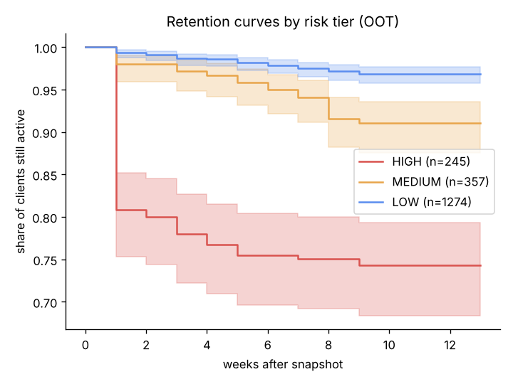
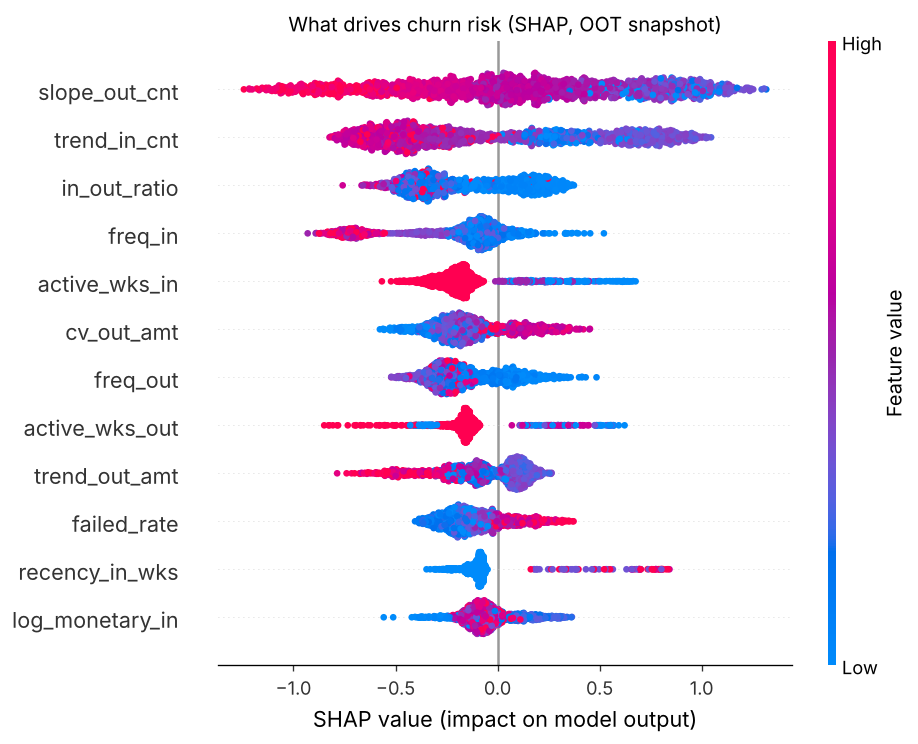

# Corporate Churn Early-Warning (XGBoost + Survival Analysis)

[](https://github.com/SMLRE/corporate-churn-survival/actions/workflows/ci.yml)

Predicts which corporate clients of a bulk-payments platform will go dormant in the next ~90 days, **how soon**, and **why**, then sorts them into risk tiers that a relationship team can act on.

> **About the data.** This is a public re-implementation of a production system I built at a commercial bank. The bank's data is proprietary and is **not** in this repo. Everything here runs on a synthetic generator that reproduces the *shape* of the problem (fading activity before churn, seasonal dips, clients who stop paying out but keep receiving funds). Table and column names are generic. The **In production** section reports the real project. Everything after it comes from the synthetic data.



## The problem

Corporate clients rarely announce that they are leaving. Their payment volumes fade over a few weeks and then stop. By the time anyone notices, the relationship is gone. The team needed to:

1. flag at-risk clients **early**, while there is still time to intervene,
2. rank them by **urgency**, and
3. explain **why** each client was flagged, so the RM conversation is specific.

## Approach

| Step | What | Where |
|---|---|---|
| Churn definition | **Authentic churn** = dormant in *both* directions (no outbound **and** no inbound payments) in the final 8 weeks of a 13-week outcome window. Clients that stop paying out but still receive funds are not counted as churn. | `sql/01_population_and_label.sql` |
| Features | Recency, frequency and monetary value per direction, payment failure rate, inbound/outbound ratio, recent-vs-earlier trends, normalised slope and volatility. All built over a 13-week (~90-day) window. | `sql/02_*.sql`, `sql/03_*.sql` |
| Feature selection | Iterative **VIF** reduction (threshold 5) removes correlated RFM features so that SHAP explanations stay stable. | `src/select_features.py` |
| Who | **XGBoost** with class re-weighting and early stopping. | `src/models.py` |
| When | **Cox proportional hazards** on standardised features, giving hazard ratios per 1 SD. | `src/models.py` |
| Why | **SHAP** values, plus the top three reasons for each client. | `run_pipeline.py` |
| Action | Two tiers: **High ≥ 0.55** (RM outreach) and **Medium 0.35–0.55** (lighter-touch campaign). | `src/models.py` |
| Validation | Trained on the week-52 snapshot and tested **out of time** on the week-65 snapshot. | `run_pipeline.py` |

The SQL is portable and runs on **DuckDB** here. The production version ran on Oracle.

## In production (the real project)

This model was built and deployed at a commercial bank in 2026 for its corporate bulk-payments platform.

| | |
|---|---|
| **ROC-AUC** | **0.861** in-time · **0.883** on out-of-time validation |
| **Final feature set** | **11 features** after VIF reduction, from Oracle SQL RFM + trend features over a 90-day observation window |
| **Explainability** | SHAP, per client |
| **Deployment** | Two tiers: **High Risk ≥ 0.55**, **Medium Risk 0.35–0.55**, with scores surfaced in the bank's customer-360 platform |
| **Delivered** | Full notebook, feature documentation and a 15-slide ExCo deck |

**Key decision:** the first churn definition looked only at outbound payments. It was refined to **authentic churn**, which requires both outbound *and* inbound activity to stop, so that clients still receiving funds were not flagged as lost. This repo implements that refined definition.

## Results on the synthetic reproduction

| Metric | Value |
|---|---|
| ROC-AUC (validation) | 0.856 |
| **ROC-AUC (out-of-time)** | **0.844** |
| Gini (out-of-time) | 0.688 |
| Cox C-index (out-of-time) | 0.806 |
| Features after VIF | 18 of 21 |

**Tiers on the out-of-time snapshot:**

| Tier | Clients | Churn rate | Share of all churners | Lift |
|---|---|---|---|---|
| High | 245 (13%) | 24.5% | **61%** | 4.7× |
| Medium | 357 | 4.2% | 15% | 0.8× |
| Low | 1,274 | 1.8% | 24% | 0.3× |

The High tier holds 13% of clients but **61% of the churners**, so outreach can be aimed at a small list.



The biggest drivers are a falling outbound slope and falling inbound activity: the "fade". Payment failures also raise risk, which suggests a service-quality fix and not only a sales one.

## Run it

```bash
pip install -r requirements.txt
python run_pipeline.py          # generates data, trains, writes reports/
```

Or open `notebooks/walkthrough.ipynb` for the narrated version.

## Repo layout

```
data/generate_synthetic.py     synthetic clients + weekly payment flows
sql/01_population_and_label.sql
sql/02_rfm_features.sql
sql/03_trend_features.sql
sql/04_model_base.sql
src/features.py                runs the SQL in DuckDB for a snapshot
src/select_features.py         iterative VIF reduction
src/models.py                  XGBoost, Cox PH, tiering
run_pipeline.py                end-to-end run -> reports/
notebooks/walkthrough.ipynb    narrated walkthrough, executed
reports/                       metrics.json, figures, scored output
```

## Author

**Oluwasemilore Sadare**, Data Scientist · [LinkedIn](https://www.linkedin.com/in/oluwasemilore-sadare) · [Portfolio](https://github.com/SMLRE)
